<div align="center">
  <h1>ZNirmaan Portal</h1>
  <p><strong>3D Land Records with a 3D-ULPIN for Every Space</strong></p>
  <p>Every flat, parking bay, common area and underground line gets its own code, on a real 3D map of Pune.</p>
  <p>
    
    
    
    
    
    
    
  </p>
</div>

---

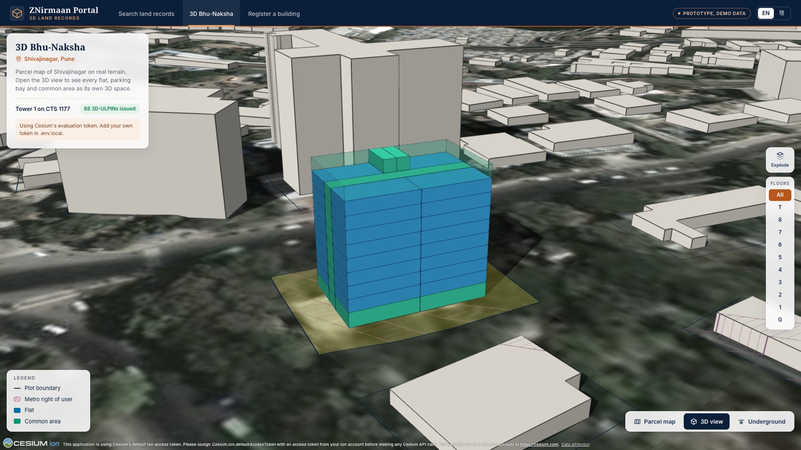

ZNirmaan Portal is the frontend of a **3D land records system**, built for the Smart India Hackathon problem *3D ULPIN Generation and Vertical Property Mapping*. India's ULPIN gives each land parcel a 14-character ID, but in a city one plot carries a whole building of owners stacked floor above floor, shared lobbies and parking, and sometimes a metro tunnel underneath. This portal gives each of those spaces its own **3D-ULPIN** and shows them where they really are: in 3D, on the real terrain and buildings of Shivajinagar, Pune.

It is a working prototype with fictional records and no backend. Everything runs in the browser.

## Contents

- [Screenshots](#screenshots)
- [Features](#features)
- [The 3D-ULPIN](#the-3d-ulpin)
- [Architecture](#architecture)
- [Getting started](#getting-started)
- [Demo script](#demo-script)
- [Testing](#testing)
- [Demo data](#demo-data)
- [Project structure](#project-structure)
- [Tech stack](#tech-stack)
- [Credits](#credits)

## Screenshots

| | |
|---|---|
| **A flat selected:** its 3D-ULPIN, rights and the plot's spaces<br/>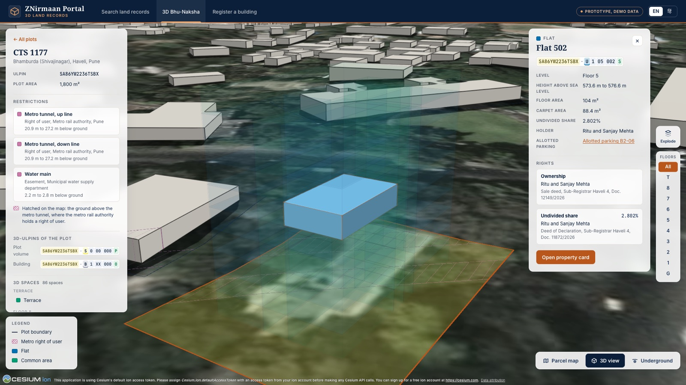 | **Explode floors:** every flat pulled apart and visible<br/>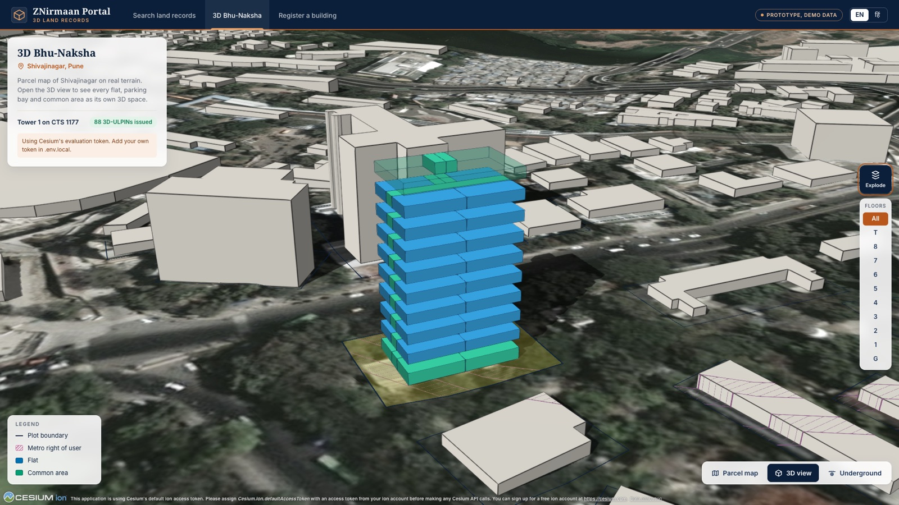 |
| **One floor as a plan:** the floor picker shows floor 5 from above<br/>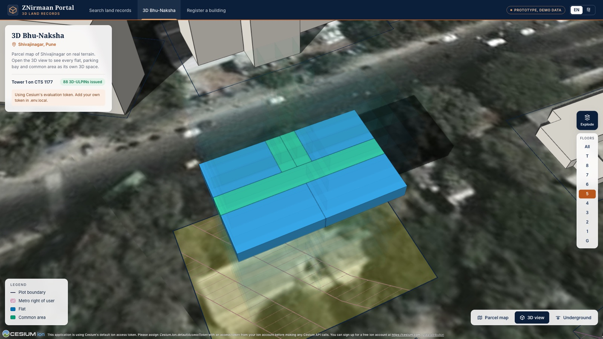 | **Underground:** basements, metro tunnels and the water main<br/>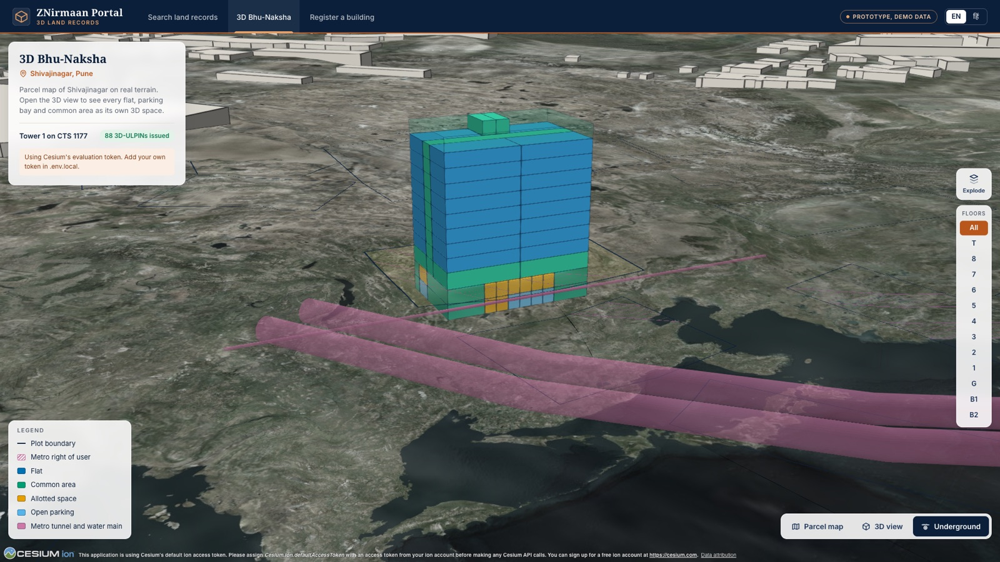 |
| **Parcel map:** the metro's right of user hatched on the plots above it<br/>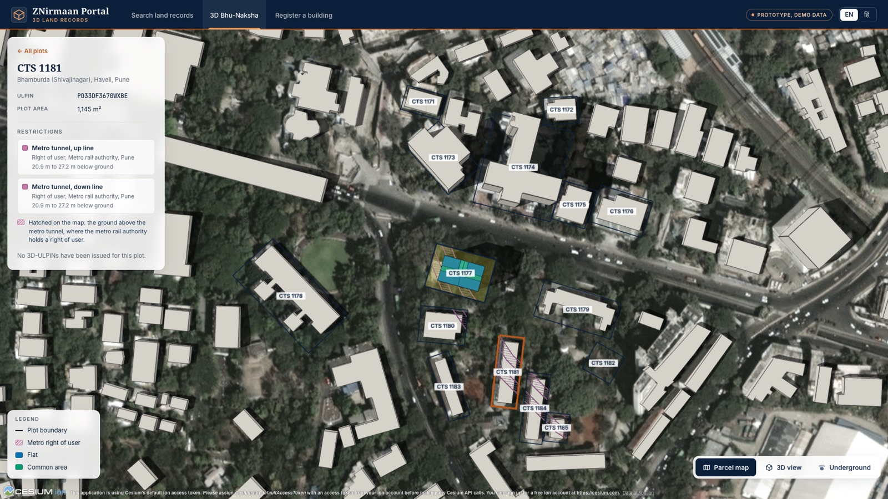 | **Register a building:** the six survey data sources<br/>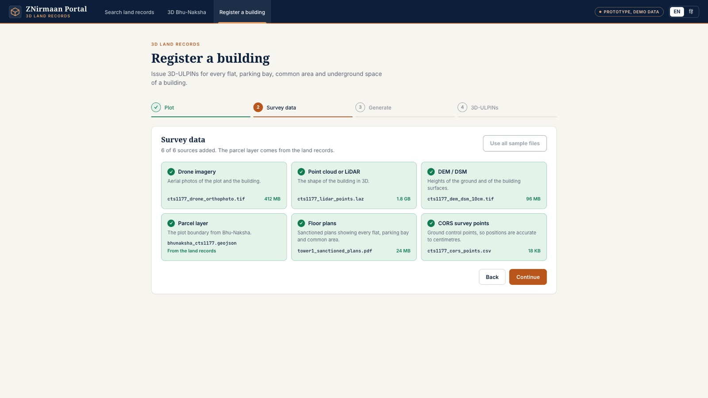 |
| **88 new 3D-ULPINs,** grouped by type<br/>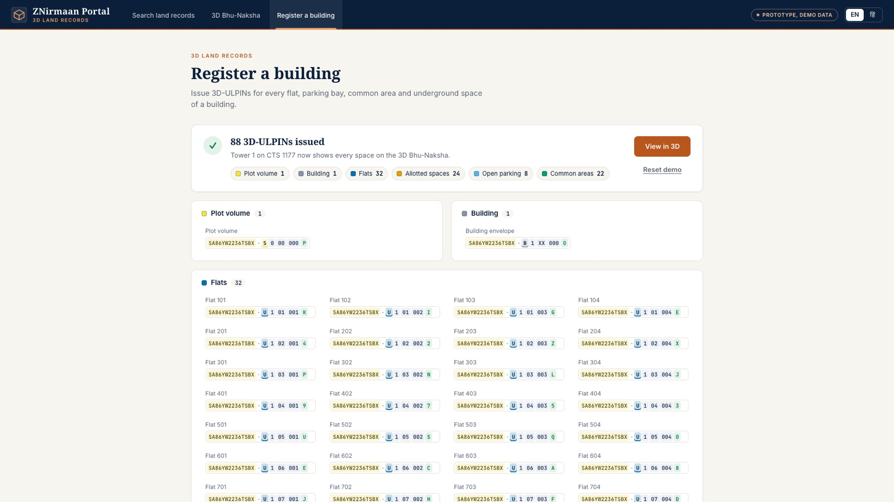 | **Search with a typing mistake:** marked and corrected<br/>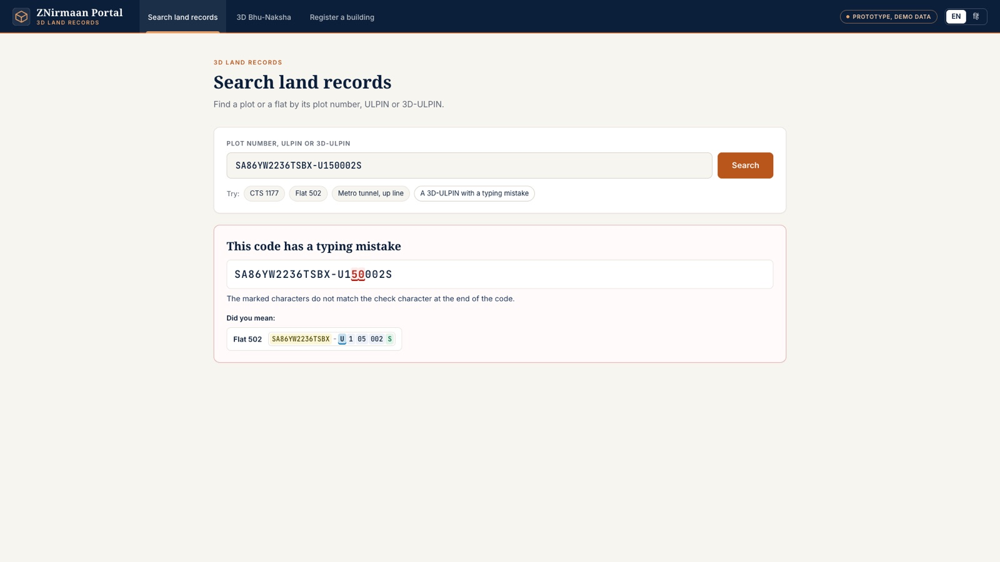 |
| **Every code explained** part by part<br/>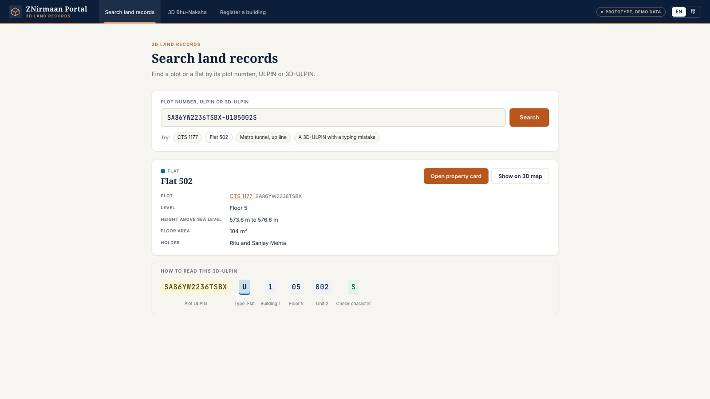 | **3D property card** with a drawing and a QR code<br/>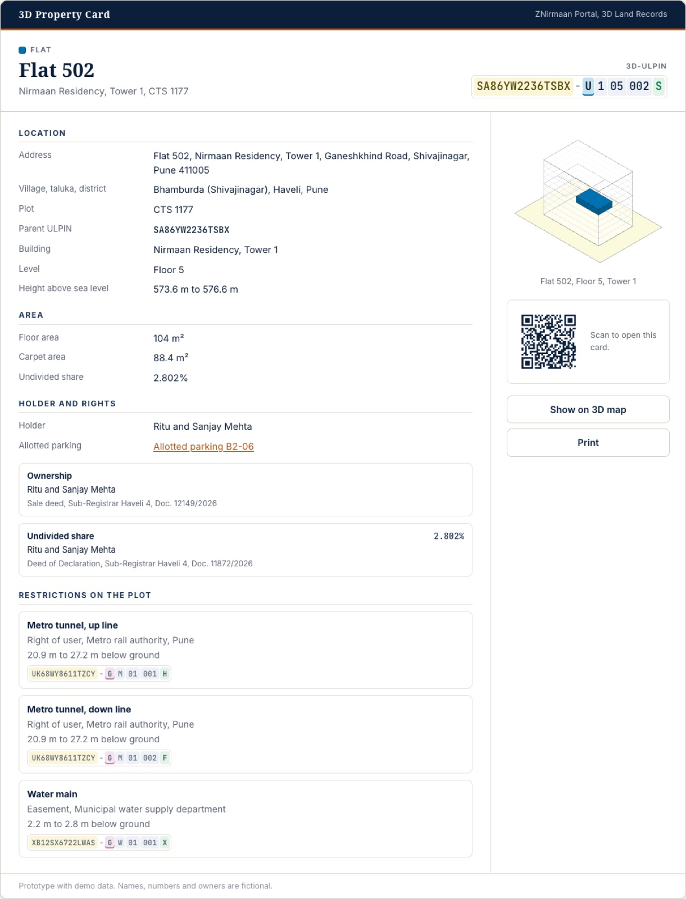 |
| **Hindi:** every label, name, place and document<br/>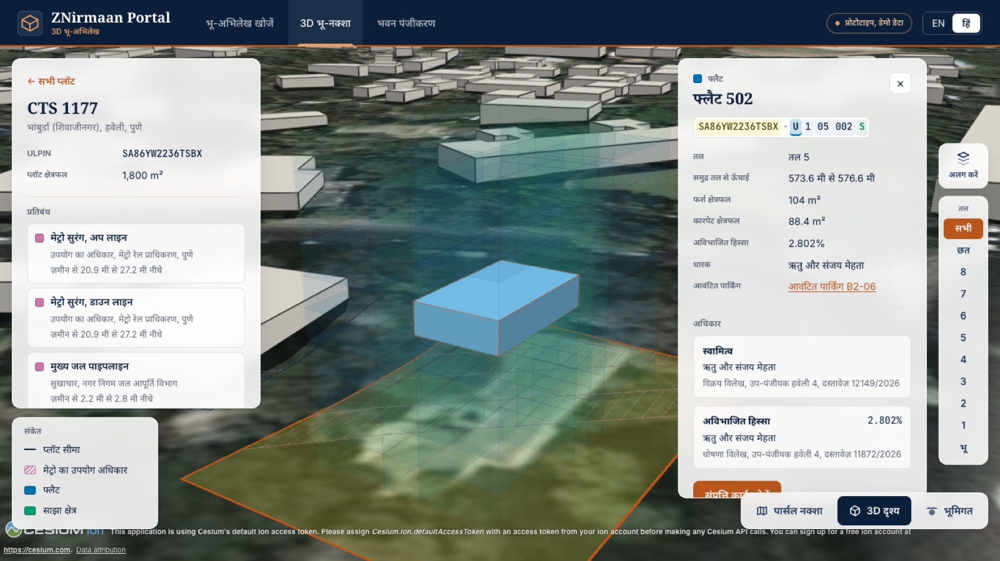 | |

## Features

### 1. 3D Bhu-Naksha: the 3D cadastral map

The main screen. Three views, switched at the bottom right:

| View | What you see |
|---|---|
| **Parcel map** | Top-down map of 15 plots on aerial imagery, each outlined and numbered (CTS 1171 to CTS 1185), like the Bhu-Naksha maps land offices use today |
| **3D view** | The same plots on real terrain, among the real buildings of Shivajinagar (drawn in off-white so the records stand out). Tower 1 on CTS 1177 stands as one solid block per legal space |
| **Underground** | The ground around the site fades to 30%. The two basements, both metro tunnels and the water main show underneath; buildings standing on the faded ground are hidden so they do not float |

**One block per legal space.** Tower 1 is not a building model; it is its records. Each of its 86 spaces is a 3D volume in its true position and size, coloured by type with a colour-blind-safe palette:

| Colour | Type | In Tower 1 |
|---|---|---|
| Blue | Flat | 32 flats, 4 per floor on floors 1 to 8 |
| Orange | Allotted space | 24 parking bays allotted to flats |
| Light blue | Open parking | 8 bays |
| Green | Common area | Corridors, lobby, staircase, lift, society office, terrace and more |
| Pink | Underground | Metro tunnels and the water main |

**Explore the tower.**
- **Hover** a block to see its name and floor; **click** it for its details panel: 3D-ULPIN, floor, height above sea level, floor and carpet area, undivided share, holder, allotted parking, and every right with the deed it comes from.
- **Explode** pulls the floors apart in a smooth animation, so no flat is hidden behind another.
- **The floor picker** shows one floor and fades the rest. With nothing selected, the camera looks down on that floor so it reads like a floor plan.
- **Click a plot** for its ULPIN, area, restrictions and, for Tower 1, the list of all its spaces floor by floor.
- **Shareable links.** `#/map?code=SA86YW2236TSBX-U105002S` opens the map, flies to Flat 502 and selects it.

**Underground and rights of others.** The metro runs 21 to 27 m below Tower 1 and four neighbouring plots. Each tunnel and the water main is a 3D space with its own G-type 3D-ULPIN, depth, height above sea level, diameter, the plots it runs under, and the right it holds (the metro's *right of user*, the water department's *easement*). On every plot above a tunnel, the strip of ground directly above it is **hatched in every view**, and the plot's panel explains why.

### 2. Register a building

How the codes come into being, and the opening of the demo. Four steps:

1. **Plot.** All 15 plots without 3D-ULPINs are listed. Only CTS 1177 has building data submitted, so only it can be picked; its details show to confirm. "Register this plot" on the map arrives here with the plot already picked.
2. **Survey data.** Six slots for the sources the problem statement names: drone imagery, point cloud or LiDAR, DEM / DSM, the parcel layer (filled automatically from the land records), floor plans and CORS survey points. Each takes a sample file; "Use all sample files" fills them in one click.
3. **Generate.** A short, calm progress bar while 88 codes are issued.
4. **Codes.** All 88 3D-ULPINs grouped by type (plot volume 1, building 1, flats 32, allotted spaces 24, open parking 8, common areas 22), each linking to its space on the map, plus the 3 underground lines already registered below the plot.

Registering switches Tower 1 from a grey "Not registered" block to its coloured spaces on every screen, and is remembered across reloads. **Reset demo** on the same page puts it back. The codes are the same every time.

### 3. Search land records

One box takes a plot number (`1177` or `CTS 1177`), a ULPIN, or a 3D-ULPIN, in any case and with or without the hyphen.

- **A plot** shows its record and all its 3D spaces. Before Tower 1 is registered, its plot says "No 3D-ULPINs issued yet" and links to Register.
- **A flat, bay or line** shows its record, with "Open property card" and "Show on 3D map".
- **A typing mistake** is caught by the check character. The wrong characters are marked in red and the right code is suggested: two swapped digits, as in `...-U150002S` for `...-U105002S`, are both marked, and "Did you mean: Flat 502" opens it.
- **A code with the wrong shape** (for example a type letter that does not exist) is explained: the part that breaks the scheme is marked and the rule is spelled out.
- **Every result** comes with the code explained part by part: plot ULPIN, type, building, floor, unit and check character.

### 4. 3D property card

The record of one space, laid out as a formal property card and opened from the map, from Search, from Register or from its own QR code:

- 3D-ULPIN, parent ULPIN, address, village, taluka and district, building, floor and height above sea level
- Floor area, carpet area and undivided share
- Holder, and every right with its document (sale deed, deed of declaration, allotment letter)
- Allotted parking, linking to the bay's own card, and back from the bay to its flat
- Restrictions on the plot: the metro tunnels and the water main below, with their depths and codes
- An isometric drawing of the tower with this space highlighted, drawn as SVG
- A QR code that opens this card, and a print layout that fits one A4 page

### 5. English and Hindi

The EN / हिं switch in the header changes every screen, including the record text: owner names, the building, road, village and taluka, the authorities and deed references are shown in Devanagari (for example *उप-पंजीयक हवेली 4, दस्तावेज़ 12149/2026*). Codes, ULPINs and file numbers stay as they are. Fonts are bundled, so Hindi renders correctly offline and on any laptop.

## The 3D-ULPIN

A 3D-ULPIN is the 14-character ULPIN of the plot, a hyphen, and 7 characters that place the space inside it:

```
SA86YW2236TSBX - U  1  05  002  S
└── plot ULPIN ┘   │  │  │   │   └ check character
                   │  │  │   └ unit on that level
                   │  │  └ level (floor)
                   │  └ building on the plot
                   └ type of space
```

| Field | Values |
|---|---|
| Type | `S` plot volume, `B` building, `U` flat (unit), `L` allotted space, `C` common area, `P` open parking, `G` underground segment |
| Building | `0` for the plot itself, `1` to `9` and `A` to `Z` for buildings on it |
| Level | `00` ground, `01` to `99` floors, `B1` to `B9` basements, `M1` to `M9` mezzanines, `RF` roof, `XX` spans several levels (stairs, lifts) |
| Unit | 3 characters, `001` upwards |
| Check | ISO 7064 MOD 37,36 over all 21 characters. It catches every single wrong character and nearly every swap of two neighbouring characters (more than 99.8% in our tests) |

Underground lines cross many plots, so they cannot belong to one. Each network gets its own 14-character root instead, the building field becomes the network (`M` metro, `W` water), and the level and unit fields number the segment. The plots above keep a restriction that points to the segment's code.

## Architecture

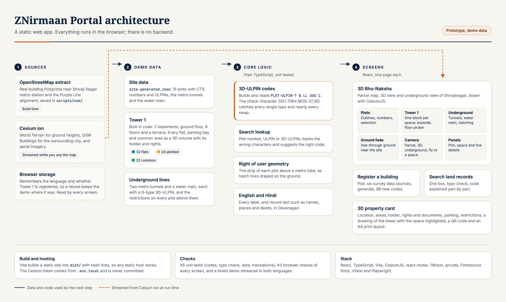

The same, as a diagram GitHub draws from text:

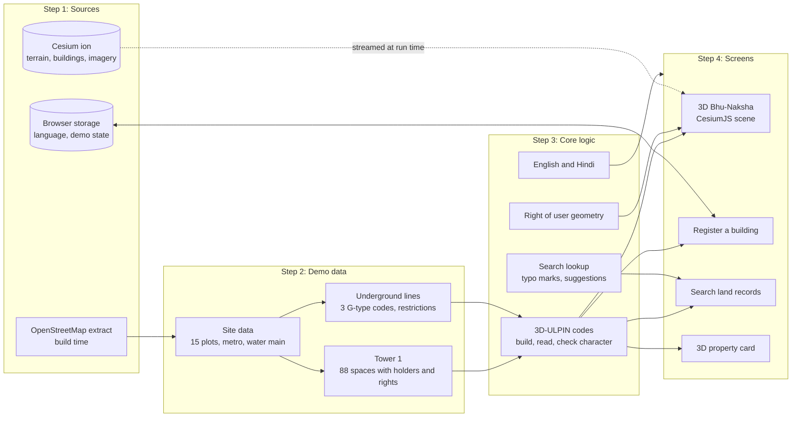

**How it fits together**

| Layer | Where | What it does |
|---|---|---|
| Sources | `scripts/osm/`, Cesium ion | A saved OpenStreetMap extract gives the real plot shapes and the metro alignment. Cesium ion streams the terrain, the surrounding buildings and the imagery while the map is open |
| Demo data | `src/data/` | `npm run data` turns the extract into `site.generated.json`. Tower 1 is built in code: every space as a footprint and a height range, with its holder, rights and documents. Codes are derived, never stored, so they are the same every time |
| Core logic | `src/lib/`, `src/i18n/` | Plain TypeScript with unit tests: the 3D-ULPIN format and check character, the search lookup with typo marking, the hatching geometry, and the translations |
| State | `src/state/` | One small store for "is Tower 1 registered", kept in local storage so the demo survives a reload |
| Map scene | `src/map/` | CesiumJS. Tower 1 is drawn as one set of primitives per floor, so exploding the floors moves whole floors at once and restyling a block is a cheap attribute change. The underground view uses globe translucency limited to the area around the site |
| Screens | `src/pages/` | React pages with hash routing (`#/map`, `#/register`, `#/search`, `#/card/:code`), so the build runs on any static host |

**Design choices**
- **No backend.** A static build can be hosted anywhere. Once the page is open, Register, Search and the property cards need no network; only the 3D map streams data.
- **Records first, geometry second.** Every block on the map is a legal space from the data, not a mesh from a model, so what you click is exactly what the card prints.
- **The check character does the work.** Search can mark a typing mistake precisely because every code carries a MOD 37,36 check, and the suggestion comes from the codes that are actually on record.

## Getting started

**You need:** Node.js 20 or newer, and a free Cesium ion account.

1. Install the dependencies:
   ```bash
   npm install
   ```
2. Add your Cesium ion token:
   - Create a free account at https://ion.cesium.com and copy a token from **Access Tokens**.
   - Copy `.env.example` to `.env.local` and paste the token after `VITE_CESIUM_ION_TOKEN=`.

   Without a token the map uses Cesium's evaluation token and shows a notice. `.env.local` is git-ignored, so the token never reaches GitHub.
3. Start the app:
   ```bash
   npm run dev
   ```
   and open the address it prints.

The 3D city streams from Cesium's servers, so the map needs an internet connection; without one it says so. Once the page is open, Register, Search and the property cards work without a network.

**Hosting.** `npm run build` writes a static site to `dist/`. It uses hash links, so it works on any static host with no server settings. Build with your token in `.env.local`. The QR codes on the property cards point to wherever the site is hosted.

## Demo script

About 6 to 8 minutes. Open the site once beforehand so the map is cached, and pick the language.

1. **Reset demo.** Open *Register a building*. If the tower is already registered, press **Reset demo**.
2. **Register a building.** Pick CTS 1177, press **Continue**, **Use all sample files**, **Continue**, then **Generate 3D-ULPINs**. Point out the 88 codes and the counts per type.
3. **3D view.** Press **View in 3D**. Tower 1 now stands as coloured spaces on its plot.
4. **Explode floors and the floor picker.** Press **Explode**, then floor **5** to see it as a plan. Click a flat for its 3D-ULPIN and rights. Press **All** and **Explode** again to put it back.
5. **Underground view.** Press **Underground**. Show the basements, the metro tunnels and the water main, and click a tunnel for its code and the metro's right of user. In the parcel map, the plots above the tunnel are hatched.
6. **Property card.** Open Flat 502 from the plot's list of spaces and press **Open property card**: the drawing, the rights and documents, the allotted parking and the QR code.
7. **Search with a typo.** Open *Search land records* and press **A 3D-ULPIN with a typing mistake**. The swapped digits are marked and Flat 502 is suggested.
8. **Switch to Hindi.** Press **हिं** in the header; every screen switches, names and places included.

`npm run rehearse` runs this script in a test browser, in English and in Hindi, and saves a screenshot per step and a video of each run.

## Testing

| Command | What it checks |
|---|---|
| `npm test` | 45 unit tests: the 3D-ULPIN format and check character (every single-character typo is caught), the search lookup and typo marking, the demo data (no two spaces overlap, the metro passes well clear of the basements), the hatching geometry, and that every English text has a Hindi one |
| `npm run interact` | 43 checks in a real browser: Register end to end, Search (valid codes, typos, wrong shapes), the property cards and their print layout, the map (select, explode, floor picker, underground, links), and the message shown when the 3D city cannot load |
| `npm run rehearse` | The demo script above, timed, in both languages, with screenshots and videos |
| `npm run shots` | Screenshots of every screen at 1366×768 and 1920×1080 in English and Hindi |
| `npm run diagram` | Re-renders `docs/images/architecture.png` from `docs/architecture/architecture.html` |
| `npm run typecheck` | TypeScript, strict |
| `npm run lint` | ESLint |

`interact`, `rehearse` and `shots` run against the production build, so run `npm run build` first. Output goes to `screenshots/`, which is git-ignored.

## Demo data

All records are fictional; the geography is real.

- **Real:** the plot shapes are drawn around real buildings near Shivaji Nagar metro station, and the metro tunnels follow the real Purple Line alignment, both from OpenStreetMap. The ground level of 558 m above sea level matches both SRTM and Cesium World Terrain with the EGM2008 geoid.
- **Fictional:** owners, CTS numbers, ULPINs, deed numbers and the tower itself. The village and taluka (Bhamburda, Haveli) follow how Shivajinagar property is usually described in deeds.
- **Depths:** the metro tunnels are 6.3 m across with their centre 24 m below ground (20.9 to 27.2 m); the water main is 2.2 to 2.8 m below ground. The deepest basement floor is 6.6 m below ground, so more than 10 m of ground separates it from the tunnels.

Open `#/debug` for a review page listing every code, area and right.

## Project structure

```
src/
  data/        Demo data: site, Tower 1 builder, owners, underground lines
  lib/         3D-ULPIN codes, search lookup, hatching geometry, formatting
  i18n/        English and Hindi text, and record text in Devanagari
  state/       Demo state (is Tower 1 registered), kept in local storage
  map/         The CesiumJS map
    scene/     Plots, Tower 1, underground lines, ground fade, camera
    panels/    Plot, space and line panels
  pages/       Register, Search, property card, map page, debug page
  components/  Header, code chip, code explainer, QR code, page layout
scripts/       Site data builder, screenshots, browser checks, rehearsal, diagram
docs/          README images and the architecture diagram source
```

## Tech stack

| Area | Tools |
|---|---|
| App | React 19, TypeScript, Vite, react-router (hash routing) |
| 3D map | CesiumJS with Cesium World Terrain, Cesium OSM Buildings and aerial imagery |
| Languages | i18next, react-i18next |
| Property card | qrcode, hand-drawn SVG |
| Fonts | Inter, Noto Serif, Noto Sans and Serif Devanagari, JetBrains Mono (Fontsource, bundled) |
| Quality | Vitest, Playwright, ESLint |

## Credits

- Map data © [OpenStreetMap](https://www.openstreetmap.org/copyright) contributors, available under the Open Database License.
- 3D terrain, buildings and imagery from [Cesium ion](https://cesium.com/platform/cesium-ion/).
- Space colours from the Okabe-Ito colour-blind-safe palette.

<div align="center">
  <sub>Built by Team ZNirmaan for the Smart India Hackathon 2026.</sub>
</div>
